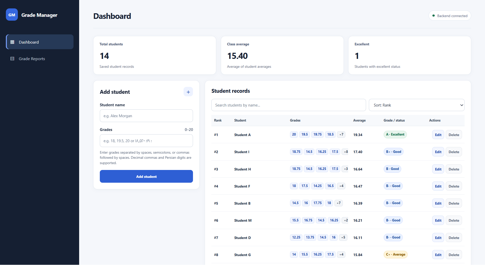

# Grade Manager — Student Performance Management System

A student grade management application built with Python, featuring a console-based version and a web-based application with a REST API.

## About This Project

Grade Manager is a personal project developed in two versions:

- **Console Version:** Designed and implemented entirely independently by me, without AI assistance. This version helped me practise Python fundamentals, problem-solving, data structures, and program design.
- **Web Version:** Developed with assistance from ChatGPT. I worked on understanding and implementing the backend architecture, database integration, REST API, frontend communication, debugging, and automated testing.

The project reflects my progression from fundamental Python programming to building a structured web application.

## Features

### Student Management
- Add, update, and delete student records
- Prevent duplicate student names
- Validate student information and grades
- Store multiple grades for each student

### Grade Calculation and Reporting
- Calculate student averages
- Convert numerical grades into letter grades
- Determine academic performance status
- Generate individual student reports
- Generate class-level performance summaries

### Backend and Database
- RESTful API built with FastAPI
- SQLite database integration
- Data validation using Pydantic
- Database transactions and rollback handling
- Automatic migration from legacy JSON data
- Foreign key constraints and cascading deletion

### Frontend
- Web-based student management dashboard and grade reports
- Shared competition ranking across dashboard and reports (1, 2, 2, 4)
- Search and five sorting options without changing a student's rank
- Shared grade/status badges and compact grade chips with full-list tooltips
- Performance chart with status-based colors, a 0–20 scale, and a passing threshold
- At-risk student summary with names
- Responsive stacked student cards on screens below 768px
- Automatic data refresh after create, edit, delete, and page navigation
- Keyboard focus indicators and accessible form/table labels

## Technology Stack

| Area | Technologies |
|---|---|
| Programming Language | Python |
| Backend | FastAPI |
| Database | SQLite |
| Data Validation | Pydantic |
| Frontend | HTML, CSS, JavaScript |
| Testing | Pytest, HTTPX |
| Code Coverage | pytest-cov |

## Project Structure

```text
grade-manager/
├── backend/
│   ├── routes/
│   │   ├── __init__.py
│   │   ├── students.py
│   │   └── reports.py
│   ├── __init__.py
│   ├── calculations.py
│   ├── database.py
│   ├── main.py
│   ├── models.py
│   └── storage.py
├── frontend/
│   ├── css/
│   │   └── style.css
│   ├── js/
│   │   ├── app.js
│   │   └── students.js
│   └── index.html
├── tests/
│   ├── test_api.py
│   ├── test_calculations.py
│   ├── test_database.py
│   ├── test_models.py
│   └── test_storage.py
├── screenshots/
├── .gitignore
├── requirements.txt
├── restore_stage5_data.py
└── README.md
```

## Screenshots

### Dashboard


### Grade Reports


### Performance Statistics


### Student Management


## Installation and Setup

### 1. Clone the repository

```bash
git clone https://github.com/Amirali-Modavi/grade-manager.git
cd grade-manager
```

### 2. Create a virtual environment

```bash
python -m venv venv
```

Activate it on Windows:

```bash
venv\Scripts\activate
```

On macOS and Linux:

```bash
source venv/bin/activate
```

### 3. Install dependencies

```bash
python -m pip install -r requirements.txt
```

### 4. Run the application

```bash
uvicorn backend.main:app --reload
```

Open the application in your browser:

```text
http://127.0.0.1:8000
```

FastAPI interactive documentation:

```text
http://127.0.0.1:8000/docs
```

Alternative API documentation:

```text
http://127.0.0.1:8000/redoc
```

## API Endpoints

| Method | Endpoint | Description |
|---|---|---|
| GET | `/api/students` | Retrieve all students |
| POST | `/api/students` | Create a new student |
| PUT | `/api/students/{student_id}` | Update a student |
| DELETE | `/api/students/{student_id}` | Delete a student |
| GET | `/api/reports/students` | Retrieve student reports |
| GET | `/api/reports/summary` | Retrieve class summary |
| GET | `/api/health` | Check API health |

## Testing

The backend is tested using Pytest.

Run the test suite:

```bash
python -m pytest -v
```

Run tests with code coverage:

```bash
python -m pytest --cov=backend --cov-report=term-missing
```

### Test Results

| Metric | Result |
|---|---:|
| Total Tests | 82 |
| Passed Tests | 82 |
| Failed Tests | 0 |
| Backend Test Coverage | 100% |
| Backend Statements Covered | 212 |
| Uncovered Backend Statements | 0 |

All 82 automated tests passed successfully, with 100% statement coverage across the backend modules.

*Coverage represents executed backend statements and does not guarantee the absence of all possible bugs.*

## Future Improvements

- User authentication and role-based access
- Improved data visualization
- Exporting reports to PDF and Excel
- Additional reporting and analytics features
- Deployment to a production environment

## Author

**Amirali Modavi**

GitHub: [Amirali-Modavi](https://github.com/Amirali-Modavi)

Repository: [Grade Manager](https://github.com/Amirali-Modavi/grade-manager)