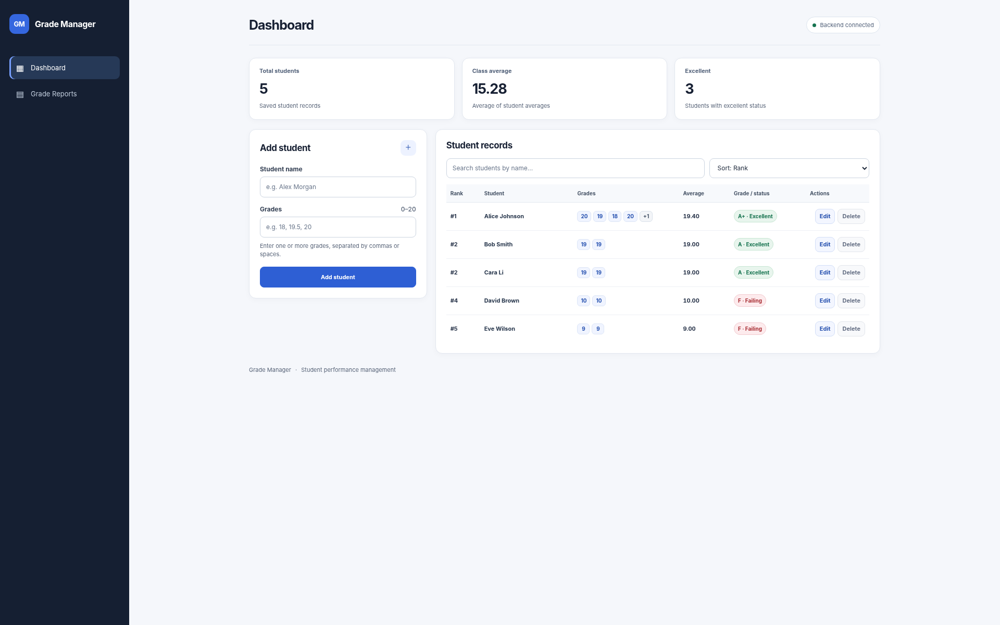

# Grade Manager — Student Performance Management System

A web-based student grade management application built with Python, FastAPI, SQLite, HTML, CSS, and JavaScript.

## About This Project

Grade Manager is a web-based student performance management system designed to provide a centralized and efficient way to manage student records, track academic progress, and analyze class performance.

Built with Python, FastAPI, SQLite, HTML, CSS, and JavaScript, the application combines a structured backend, RESTful API, and interactive frontend to provide a complete student management experience.

The system allows users to manage student information and grades, calculate academic averages, generate individual performance reports, and view class-wide statistics through a responsive dashboard.

On the backend, FastAPI handles application logic and API requests, while SQLite provides persistent data storage. Pydantic is used for data validation, and database constraints help maintain data integrity. The frontend communicates with the backend through API endpoints and provides interactive features for managing records, searching and sorting students, and viewing performance statistics.

Additional attention has been given to data consistency, Unicode-aware name validation, database migration, error handling, accessibility, and automated testing.

The project initially started as a small console-based Python application and gradually evolved into the web-based system presented in this repository.

## Learning Journey & AI Assistance

Grade Manager is a personal learning project developed to strengthen my Python programming skills and gain practical experience in software development.

During development, I used ChatGPT and Claude as supporting tools for code review, refactoring, and problem-solving. I reviewed suggested changes, tested functionality, and debugged issues to improve my understanding of the codebase.

The project reflects my development efforts and ongoing learning process, with AI serving as an additional development aid.

## Features

### Student Management
- Add, update, search, sort, and delete student records
- Prevent duplicate names using Unicode-aware normalization, including Persian and Arabic letter variants
- Validate student names and grades, including decimal-comma and Persian-digit input in the web form
- Store multiple grades for each student

### Grade Calculation and Reporting
- Calculate student averages and consistently classify the rounded, displayed value
- Convert numerical grades into letter grades and academic performance statuses
- Use one passing threshold for grade classification and the performance chart
- Generate individual student reports and class-level performance summaries
- Display the top 12 students in the performance chart and explicitly state when the chart is truncated

### Backend and Database
- REST API built with FastAPI
- SQLite persistence with foreign-key constraints and cascading deletion
- Data validation using Pydantic
- Safe, one-time JSON migration that validates each record before insertion and logs rejected records
- Unicode-aware name uniqueness and schema upgrade for existing databases
- Single-query student/grade retrieval and a combined reporting endpoint

### Frontend
- Responsive dashboard and grade reports
- Shared competition ranking across dashboard and reports
- Search and sorting without changing a student's rank
- Grade/status badges and compact grade chips with full-list tooltips
- Accessible forms, table labels, keyboard focus indicators, and status messages

## Technology Stack

| Area | Technologies |
|---|---|
| Programming Language | Python 3.10+ |
| Backend | FastAPI, Uvicorn |
| Database | SQLite |
| Data Validation | Pydantic v2 |
| Frontend | HTML, CSS, JavaScript |
| Testing | Pytest, HTTPX, pytest-cov |

## Project Structure

```text
grade-manager/
├── backend/
│   ├── routes/
│   │   ├── __init__.py
│   │   ├── students.py
│   │   └── reports.py
│   ├── __init__.py
│   ├── calculations.py
│   ├── database.py
│   ├── main.py
│   ├── models.py
│   └── names.py
├── frontend/
│   ├── css/style.css
│   ├── js/
│   │   ├── app.js
│   │   └── students.js
│   └── index.html
├── scripts/
│   ├── __init__.py
│   └── restore_from_backup.py
├── tests/
│   ├── test_api.py
│   ├── test_calculations.py
│   ├── test_database.py
│   ├── test_models.py
│   └── test_names.py
├── screenshots/
├── .gitignore
├── requirements.txt
└── README.md
```

## Screenshots

### Dashboard


### Student Management


### Performance Statistics


### Grade Reports


## Installation and Setup

### 1. Clone the repository

```bash
git clone https://github.com/Amirali-Modavi/grade-manager.git
cd grade-manager
```

### 2. Create and activate a virtual environment

```bash
python -m venv venv
```

Windows PowerShell:

```powershell
.\venv\Scripts\Activate.ps1
```

macOS and Linux:

```bash
source venv/bin/activate
```

### 3. Install dependencies

```bash
python -m pip install -r requirements.txt
```

### 4. Run the application

```bash
uvicorn backend.main:app --reload
```

Open the application at `http://127.0.0.1:8000`.

FastAPI documentation is available at `http://127.0.0.1:8000/docs` and `http://127.0.0.1:8000/redoc`.

## API Endpoints

| Method | Endpoint | Description |
|---|---|---|
| GET | `/api/students` | Retrieve all students |
| POST | `/api/students` | Create a student |
| PUT | `/api/students/{student_id}` | Update a student |
| DELETE | `/api/students/{student_id}` | Delete a student |
| GET | `/api/reports/overview` | Retrieve student reports and dashboard summary in one response |
| GET | `/api/reports/students` | Retrieve student reports |
| GET | `/api/reports/summary` | Retrieve the class summary and passing threshold |
| GET | `/api/health` | Check API health |

## Testing

Run the complete test suite:

```bash
python -m pytest -v
```

Run tests with coverage:

```bash
python -m pytest --cov=backend --cov-report=term-missing
```

Test totals and coverage depend on the current code and test environment; use the commands above for the latest results. Coverage reports executed statements and does not prove that every possible input or behavior has been tested.

## Optional Data Recovery

To import additional records from a local `students_backup.json` file, put that file in the project root and run:

```bash
python -m scripts.restore_from_backup
```

The utility creates a timestamped copy of the current SQLite database before importing. Existing IDs and normalized names are not overwritten. The backup file is intentionally excluded from Git because it may contain personal student data.

## Security Note

The application does not currently include authentication or role-based access. Run it locally or in a trusted environment; do not expose the write endpoints to an untrusted network without adding access control.

## Future Improvements

- User authentication and role-based access
- Exporting reports to PDF and Excel
- Additional reporting and analytics features
- Deployment to a production environment

## Author

**Amirali Modavi**

GitHub: [Amirali-Modavi](https://github.com/Amirali-Modavi)

Repository: [Grade Manager](https://github.com/Amirali-Modavi/grade-manager)
