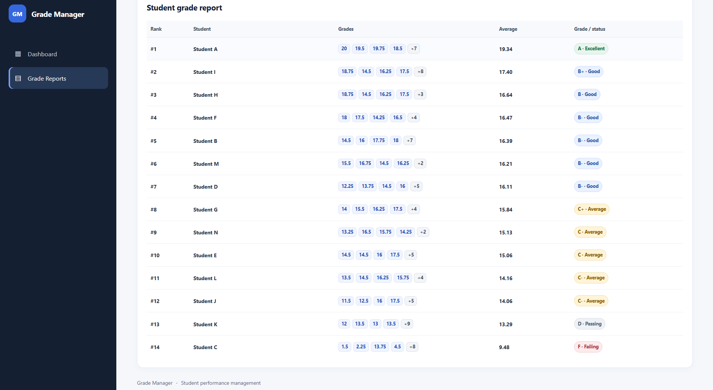
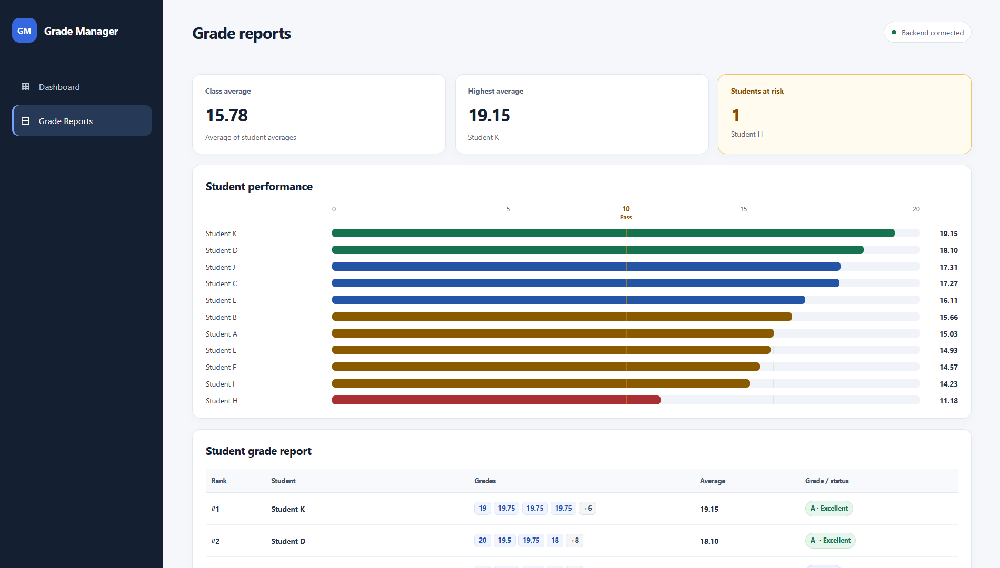

# Grade Manager — Student Performance Management System

A full-stack student grade management application built with **Python, FastAPI, SQLite, HTML, CSS, and JavaScript**.

Grade Manager allows users to manage student records, track academic performance, calculate grades, and generate performance reports through a web-based interface.

## About This Project

Grade Manager started as a console-based Python application, which I developed independently. That version used JSON for data storage and included the core grade calculation and student management functionality.

I later expanded the project into a full-stack web application. During the development of the web version, I used **ChatGPT as an AI development assistant** to help with implementation, debugging, and understanding concepts related to backend development, API design, database management, and automated testing.

This project represents my practical learning experience and my progress from basic Python programming to building a full-stack application.

## Features

- **Student Management:** Create, view, update, and delete student records.
- **Grade Validation:** Validate student names and ensure grades are between 0 and 20.
- **Automatic Calculations:** Calculate average scores, letter grades, and academic performance status.
- **Performance Reports:** Generate individual student reports and overall class summaries.
- **Search and Sorting:** Find and organize student records.
- **Data Persistence:** Store student information in an SQLite database.
- **Database Relationships:** Manage students and their grades using relational tables and foreign keys.
- **JSON Migration:** Import existing student records from the previous JSON-based version.
- **REST API:** Provide API endpoints for student management and reporting.
- **Automated Testing:** Test backend functionality using Pytest.

## Tech Stack

| Technology | Purpose |
|---|---|
| Python | Backend programming |
| FastAPI | REST API development |
| SQLite | Database |
| Pydantic | Data validation |
| HTML | Frontend structure |
| CSS | Frontend styling |
| JavaScript | Frontend functionality |
| Pytest | Automated testing |
| HTTPX | API testing |

## Project Structure

```text
grade-manager/
│
├── backend/
│   ├── routes/
│   │   ├── students.py
│   │   └── reports.py
│   ├── calculations.py
│   ├── database.py
│   ├── main.py
│   ├── models.py
│   └── storage.py
│
├── frontend/
│   ├── css/
│   │   └── style.css
│   ├── js/
│   │   ├── app.js
│   │   └── students.js
│   └── index.html
│
├── tests/
│   ├── test_api.py
│   ├── test_calculations.py
│   ├── test_database.py
│   ├── test_models.py
│   └── test_storage.py
│
├── screenshots/
│   ├── dashboard.png
│   ├── grade-reports.png
│   ├── student-management.png
│   └── performance.png
│
├── .gitignore
├── requirements.txt
└── README.md
```

## Screenshots

### Dashboard


### Grade Reports



### Student Management


### Performance Overview



## Installation and Setup

### 1. Clone the Repository

```bash
git clone https://github.com/Amirali-Modavi/grade-manager.git
cd grade-manager
```

### 2. Create a Virtual Environment

```bash
python -m venv .venv
```

### 3. Activate the Virtual Environment

**Windows PowerShell:**

```powershell
.venv\Scripts\Activate.ps1
```

**macOS / Linux:**

```bash
source .venv/bin/activate
```

### 4. Install Dependencies

```bash
python -m pip install -r requirements.txt
```

### 5. Run the Application

```bash
uvicorn backend.main:app --reload
```

Open the application in your browser:

http://127.0.0.1:8000

## API Documentation

FastAPI automatically generates interactive API documentation.

Once the application is running, visit:

- **Swagger UI:** http://127.0.0.1:8000/docs
- **ReDoc:** http://127.0.0.1:8000/redoc

### Available Endpoints

| Method | Endpoint | Description |
|---|---|---|
| GET | `/api/students` | Retrieve all students |
| POST | `/api/students` | Create a student |
| PUT | `/api/students/{student_id}` | Update a student |
| DELETE | `/api/students/{student_id}` | Delete a student |
| GET | `/api/reports/students` | Retrieve student reports |
| GET | `/api/reports/summary` | Retrieve class summary |
| GET | `/api/health` | Check API health |

## Running Tests

Run the complete test suite:

```bash
python -m pytest -v
```

Run tests with code coverage:

```bash
python -m pytest --cov=backend --cov-report=term-missing
```

### Test Results

- **82 tests passed**
- **100% backend statement coverage**
- **212 statements covered**

*These results reflect the current development test run. Code coverage measures how much of the code was executed by the tests; it does not guarantee that every possible scenario or edge case has been tested. Results may change as the project evolves.*

## Database

The application uses SQLite for persistent data storage.

The database contains separate tables for students, grades, and application metadata. Foreign key constraints maintain the relationships between student records and their grades.

Existing records from the previous JSON-based version can be imported automatically during the first database initialization.

## Future Improvements

- User authentication and authorization
- Improved API error handling
- Pagination and filtering
- Database migrations
- Deployment and production configuration

---

**Built as a personal project to practice Python backend development, REST API design, relational database management, and automated testing.**